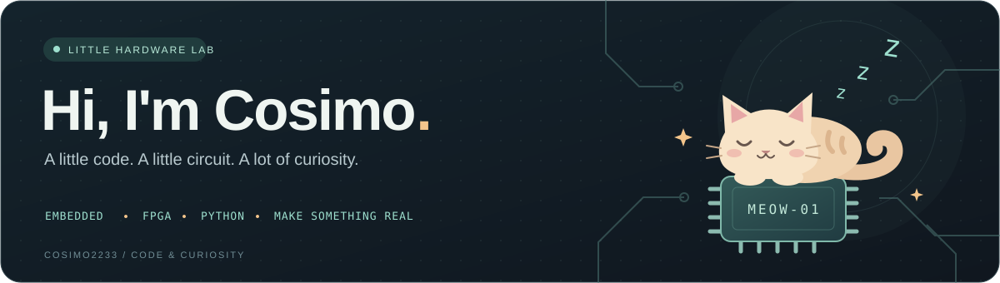

  

<h2 align="center">你好，我是 Cosimo 🐾</h2>

  <b>AAA电子厂张师傅 · 把想法焊进电路，把灵感写进代码。</b> 
  Embedded systems · FPGA · Python · Little things that work

  <a href="https://github.com/Cosimo2233?tab=repositories">项目仓库</a> ·
  <a href="https://github.com/Cosimo2233/puzzle5ev">正在折腾的 FPGA</a> ·
  <a href="https://github.com/Cosimo2233/Image-generator">像素与拼豆</a>

### 🛠️ 工位上的日常

来自中南大学，在嵌入式、FPGA 和 Python 之间探索。这里放着我的硬件改造、算法实验，还有一些让日常更有趣的小工具。

- **电路与固件** — ESP32、WCH 单片机、USB / BLE 键盘与电容触摸。
- **软硬件协同** — Zynq UltraScale+、Vivado / Vitis、视觉拼图与 PL 加速。
- **灵感与工具** — Python 几何算法、图像处理、参数化建模与拼豆图纸。

  
  
  
  
  
  

### ✨ 小小作品柜

<table>
  <tr>
    <td width="50%" valign="top">
      <h3>🧩 <a href="https://github.com/Cosimo2233/puzzle5ev">Puzzle5EV</a></h3>
      
基于 AXU5EV-P 的视觉拼图系统，探索图像处理、几何求解与 FPGA 加速的协同。

      
Zynq UltraScale+ · HLS / RTL · Python

    </td>
    <td width="50%" valign="top">
      <h3>⌨️ <a href="https://github.com/Cosimo2233/Bluetooth-keyboard">Bluetooth Keyboard</a></h3>
      
基于 CH585M 的 48 键触摸键盘固件，支持 USB / BLE 双模与 NFC 辅助配对。

      
C · USB HID · Bluetooth LE

    </td>
  </tr>
  <tr>
    <td width="50%" valign="top">
      <h3>🎨 <a href="https://github.com/Cosimo2233/Image-generator">拼豆图纸生成器</a></h3>
      
把图片变成带颜色编号的拼豆图纸，让屏幕里的像素变成手里的小作品。

      
Python · Image Processing · Pixel Art

    </td>
    <td width="50%" valign="top">
      <h3>📷 <a href="https://github.com/Cosimo2233/ESP32S3-CAM">ESP32S3-CAM</a></h3>
      
基于嘉立创 ESP32-S3 小相机的二次开发，探索小设备上的人脸识别。

      
C++ · ESP32-S3 · Embedded Vision

    </td>
  </tr>
</table>

  还可以逛逛：<a href="https://github.com/Cosimo2233/puzzle-solver">几何拼图算法</a> ·
  <a href="https://github.com/Cosimo2233/business_card">名片触摸键盘</a> ·
  <a href="https://github.com/Cosimo2233/mechanical-design">机械设计</a>

### 🐍 小蛇的每日点心

每一格绿色，都是留在这里的一点点进步。让小蛇来巡视今天的代码菜园吧。

<picture>
  <source media="(prefers-color-scheme: dark)" srcset="https://raw.githubusercontent.com/Cosimo2233/Cosimo2233/output/github-contribution-grid-snake-dark.svg" />
  <source media="(prefers-color-scheme: light)" srcset="https://raw.githubusercontent.com/Cosimo2233/Cosimo2233/output/github-contribution-grid-snake.svg" />
  
</picture>

由真实贡献记录生成 · 每日更新 · Powered by <a href="https://github.com/Platane/snk">snk</a>

---

🐈 小猫正在工位打盹，新的想法正在编译。

